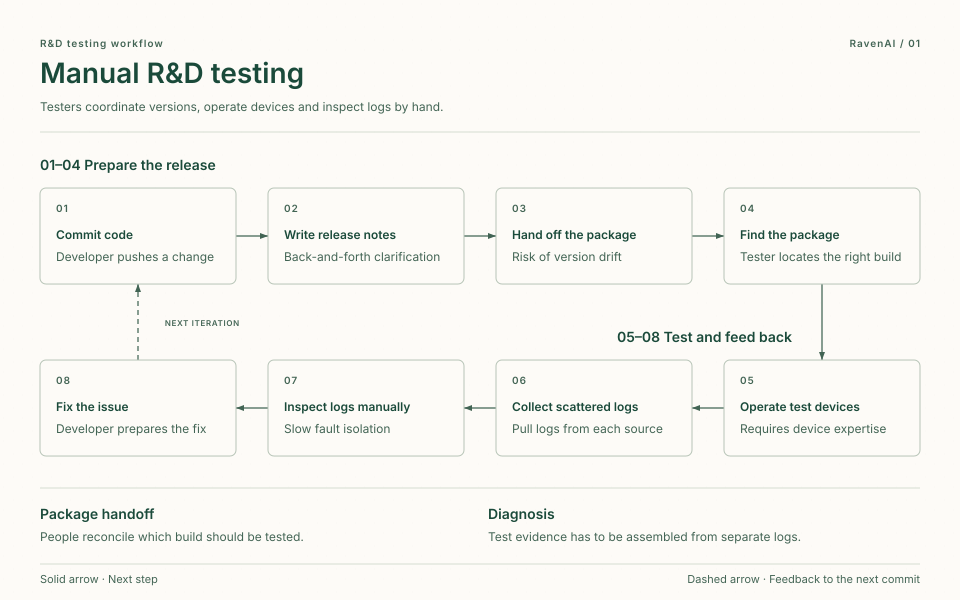
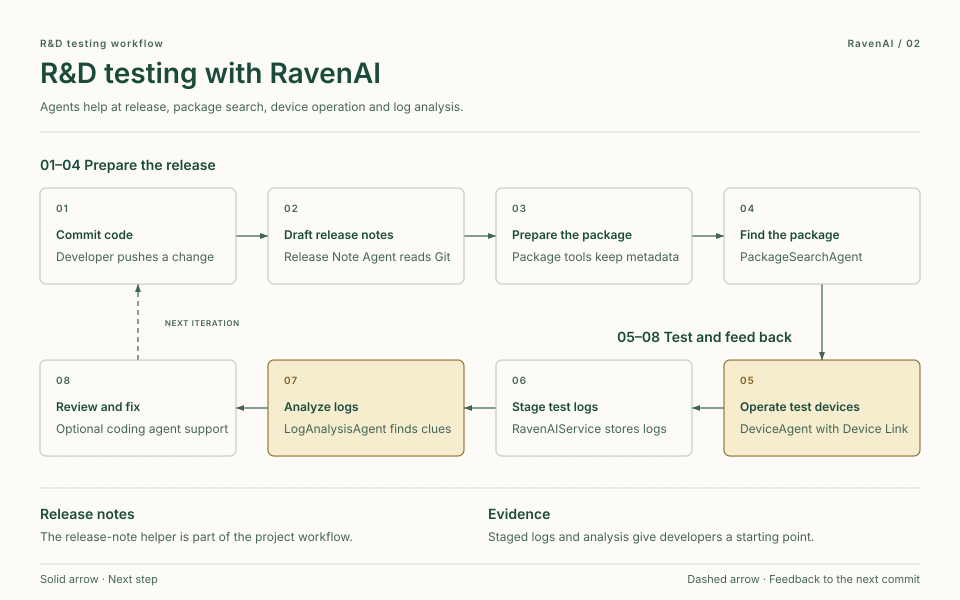
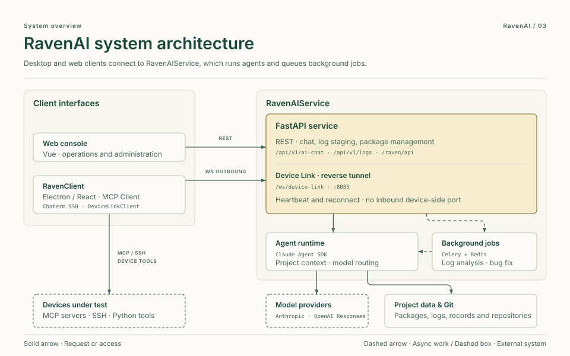
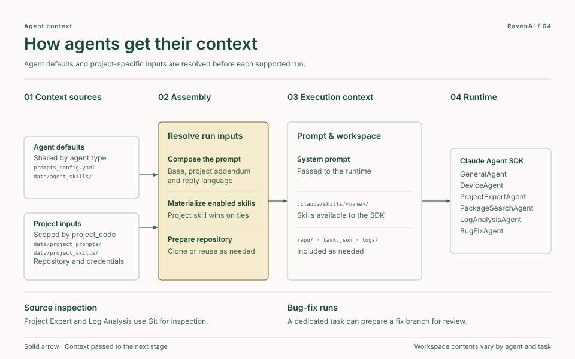

# RavenAI

English | [中文](README.zh.md)

> **RavenAI is a lightweight, open-source AI agent platform that companies can self-host for their internal R&D and testing workflows.**

RavenAI grew out of satellite communications R&D and testing. Teams can connect their existing repositories, software packages, test devices, and logs, and configure the models, prompts, skills, and access credentials for each project.

This repository is the top-level workspace for two major subprojects:

- `RavenClient`: an Electron-based desktop client built on Cherry Studio, providing MCP device operations, package creation, and AI workflows for developers and testers.
- `RavenAIService`: backend services for log staging, device-link orchestration, AI chat, asynchronous log processing, package management, and intelligent package search.

## Mission

Our mission is to help R&D and testing teams use AI agents to take code changes through validation on real devices and bring test evidence back to developers for review and fixes.

- **Integrate with existing tools** for version control, package management, and device testing.
- **Run tests in project context** so agents can find the right build and invoke the relevant device tools.
- **Keep results traceable** by retaining test logs, task records, and analysis evidence.
- **Adapt by project** with isolated context and credentials, configurable prompts, and reusable skills.

## R&D and Testing Workflow

1. Developers submit code and evolve versions through Git.
2. A lightweight Release Note Agent reads Git history and automatically drafts release notes for package-management refactors.
3. Reconstructed package management supports package creation, upload, metadata extraction, search, and distribution.
4. Testers use natural language to operate test devices through RavenClient, DeviceAgent, Device Link, MCP Server, device tools, and Python automation.
5. After testing, logs are submitted to RavenAIService and analyzed by LogAnalysisAgent to produce evidence, issue clues, and feedback for development.

## R&D Testing Flow Comparison

### Manual workflow

[](Docs/raven-testing-manual.en.html)

### RavenAI-assisted workflow

[](Docs/raven-testing-assisted.en.html)

## Architecture Overview

### System Technology Structure

[](Docs/raven-architecture.en.html)

- **RavenClient** uses Electron and React and provides package tools, an MCP client, and the Chaterm SSH terminal. The Vue web console provides operations and administration interfaces.
- **FastAPI** exposes chat, log staging, and package management. Celery and Redis handle background log-analysis and bug-fix tasks.
- The **Claude Agent SDK** runs the agents. Model routing supports providers including Anthropic-compatible endpoints and OpenAI Responses.
- **Device Link** starts when RavenClient opens a WebSocket to `/ws/device-link` on port `8085`. The client maintains the connection with heartbeats and reconnects after a disconnect. Device tools can use MCP, SSH, or Python automation.
- **Project data** includes package metadata, log archives, and task records. Agents that need source context access the selected project repository using its configured credentials.

### Agent Context Layers and Assembly

[](Docs/raven-agent-context.en.html)

- **Agent defaults** come from `prompts_config.yaml` and enabled skills under `data/agent_skills/<agent>/store`.
- **Project inputs** are scoped by `project_code`. Where supported, the service appends `data/project_prompts/<project_code>/system_prompt.md` and uses the project-level skill when both levels provide the same name.
- **Run preparation** passes the composed prompt to the runtime and places applicable skills in `.claude/skills/`. Repository checkout or reuse, `task.json`, and `logs/` depend on the agent and task.
- **Repository access** depends on the task. ProjectExpertAgent and LogAnalysisAgent use the checkout to inspect source. A dedicated BugFixAgent task can prepare and push a fix branch for human review.

## Repository Layout

```text
RavenAI/
├── RavenClient/                 # Desktop client, package tooling, MCP and device workflows
├── RavenAIService/              # Backend services, log staging, AI analysis, package management
│   ├── app/                     # FastAPI application, agents, services, tasks
│   └── frontend/                # Web frontend for service-side UI
├── Docs/                        # Project documentation and feature notes
├── .gitmodules                  # Submodule definitions
└── README.md                    # This document
```

## Quick Start

Clone the repository with submodules:

```bash
git clone --recurse-submodules <repo-url>
cd RavenAI
```

If the repository was cloned without submodules:

```bash
git submodule update --init --recursive
```

Start the backend log staging service:

```bash
cd RavenAIService
python3 -m venv venv
source venv/bin/activate
pip install -r requirements.txt
uvicorn app.main:app --host 0.0.0.0 --port 8085 --reload
```

Start the desktop client:

```bash
cd RavenClient
yarn install
yarn dev
```

## Key Services

- RavenAIService API: `http://localhost:8085`
- Package API at `http://localhost:8085/raven/api/packages`
- Update server: `RavenClient/update-server`
- Desktop client: launched through Electron during `yarn dev`

## Notes

The Release Note Agent mentioned in the workflow is part of the project process: it reads Git commit history and drafts release notes for the package-management refactor. It is included in the architecture description because it completes the R&D testing workflow, even though it is not represented as a full standalone module in this codebase.
