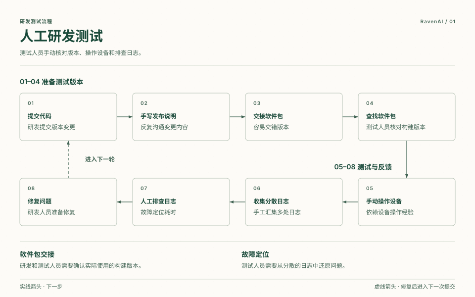
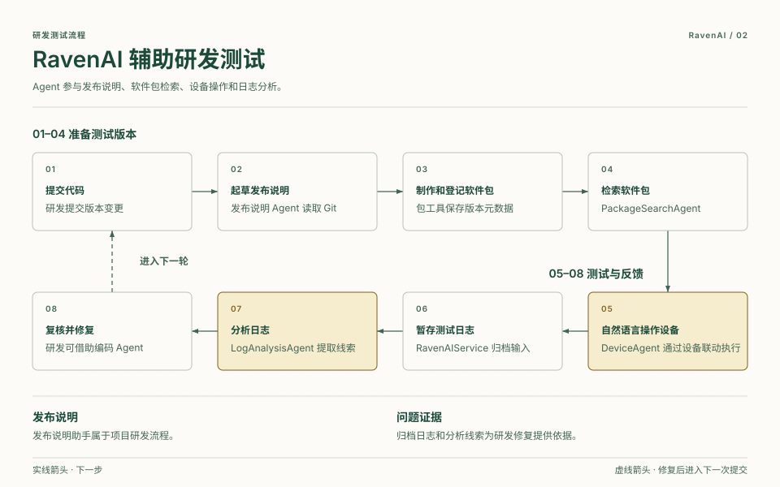
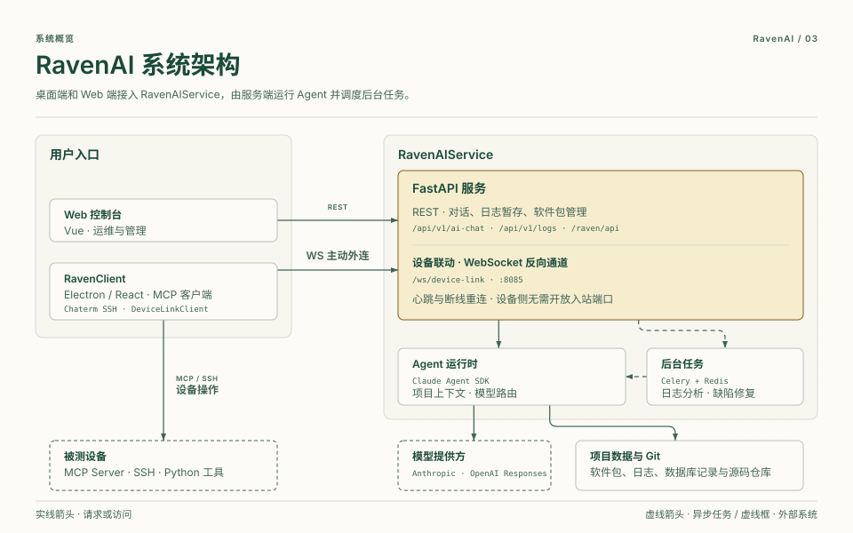
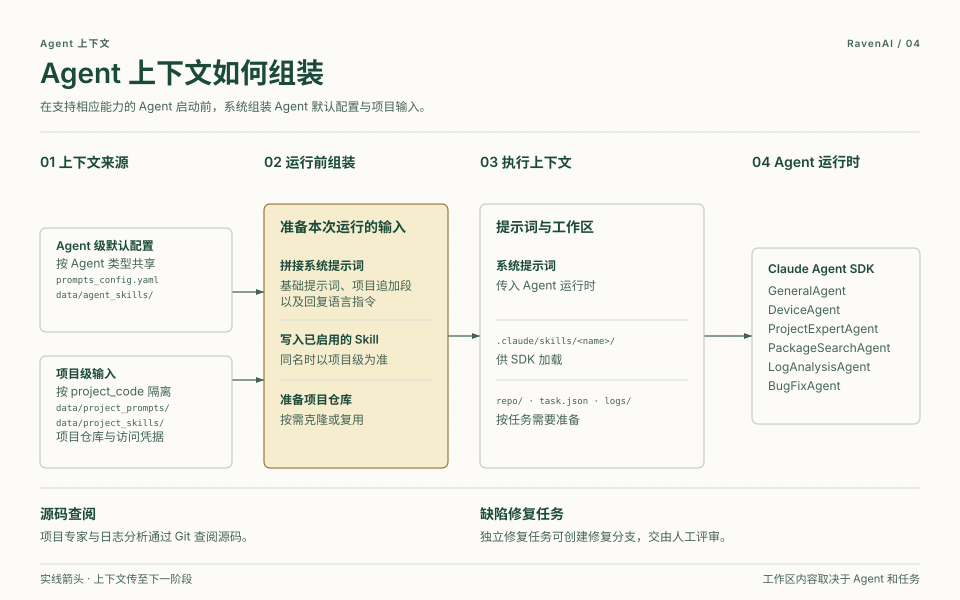

# RavenAI

[English](README.md) | 中文

> **RavenAI 是面向企业内部研发测试体系的轻量、开源 AI Agent 平台，支持自托管。**

RavenAI 起步于卫星通信研发测试。团队可以接入现有的代码库、软件包、测试设备和日志，并按项目配置模型、提示词、Skill 和访问凭据。

本仓库是顶层工作区，包含两个主要子项目：

- `RavenClient`：基于 Electron 与 Cherry Studio 定制的桌面客户端，面向研发与测试人员，提供 MCP 设备操作、升级包制作和 AI 工作流。
- `RavenAIService`：后端服务集合，提供日志暂存、设备联动、AI 对话、异步日志处理、包管理和智能包检索等能力。

## 项目使命

我们的使命是帮助研发和测试团队用 AI Agent 把代码变更推进到真实设备验证，并把测试证据带回研发环节，供开发人员复核和修复问题。

- **接入现有工具**，沿用团队已有的版本管理、软件包管理和设备测试工具。
- **结合项目上下文执行测试**，让 Agent 找到对应版本的软件包并调用设备工具。
- **保留可追溯的测试结果**，记录测试日志、任务过程和分析证据。
- **按项目适配**，隔离项目上下文和访问凭据，配置提示词并复用 Skill。

## 研发测试工作流

1. 研发人员通过 Git 提交代码并推进版本演进。
2. 简单的 Release Note Agent 读取 Git 提交历史，自动编写包管理重构相关 Release Note。
3. 重构后的包管理能力支持升级包制作、上传、元数据提取、检索和分发。
4. 测试人员通过 RavenClient、DeviceAgent、Device Link、MCP Server、设备工具和 Python 自动化脚本，用自然语言管理测试设备。
5. 测试完成后，日志提交至 RavenAIService，由 LogAnalysisAgent 分析并产出证据链、问题线索和研发回流建议。

## 研发测试流程对比

### 人工流程

[](Docs/raven-testing-manual.html)

### RavenAI 辅助流程

[](Docs/raven-testing-assisted.html)

## 技术架构概览

### 系统技术与能力结构

[](Docs/raven-architecture.html)

- **客户端层**采用 Electron 和 React，提供包工具、MCP 客户端和 Chaterm SSH 终端。Vue Web 控制台提供运维和管理入口。
- **服务层**通过 FastAPI 提供对话、日志暂存和软件包管理，使用 Celery 与 Redis 处理后台日志分析和缺陷修复任务。
- **Agent 运行时**基于 Claude Agent SDK，模型路由支持 Anthropic 兼容接口和 OpenAI Responses 等模型接入方式。
- **设备联动**由 RavenClient 主动连接服务端 `8085` 端口的 `/ws/device-link`，通过心跳维持连接并在断线后重连。设备操作可使用 MCP、SSH 或 Python 自动化工具。
- **项目数据**包括软件包及其元数据、日志归档和任务记录。需要源码上下文的 Agent 使用所选项目配置的凭据访问仓库。

### Agent 上下文分层与装配

[](Docs/raven-agent-context.html)

- **Agent 级默认配置**来自 `prompts_config.yaml` 和 `data/agent_skills/<agent>/store` 中已启用的 Skill。
- **项目级输入**按 `project_code` 隔离。支持项目上下文的 Agent 会追加 `data/project_prompts/<project_code>/system_prompt.md` 的内容。同名 Skill 以项目级为准。
- **运行前组装**把合成后的提示词传入运行时，将适用的 Skill 写入 `.claude/skills/`。源码仓库的克隆或复用、`task.json` 和 `logs/` 取决于 Agent 和任务类型。
- **仓库访问**按任务区分。项目专家和日志分析使用工作区副本查阅源码，独立的缺陷修复任务可以准备并推送修复分支，交由人工评审。

## 仓库结构

```text
RavenAI/
├── RavenClient/                 # 桌面客户端、包工具、MCP 与设备联动流程
├── RavenAIService/              # 后端服务、日志暂存、AI 分析、包管理服务
│   ├── app/                     # FastAPI 应用、agents、services、tasks
│   └── frontend/                # 服务侧 Web 前端
├── Docs/                        # 项目文档与功能说明
├── .gitmodules                  # 子模块定义
└── README.md                    # 默认英文说明文档
```

## 快速开始

克隆仓库并拉取子模块：

```bash
git clone --recurse-submodules <repo-url>
cd RavenAI
```

如果克隆时没有包含子模块：

```bash
git submodule update --init --recursive
```

启动日志暂存后端服务：

```bash
cd RavenAIService
python3 -m venv venv
source venv/bin/activate
pip install -r requirements.txt
uvicorn app.main:app --host 0.0.0.0 --port 8085 --reload
```

启动桌面客户端：

```bash
cd RavenClient
yarn install
yarn dev
```

## 关键服务

- RavenAIService API：`http://localhost:8085`
- 软件包列表 API 位于 `http://localhost:8085/raven/api/packages`
- 更新服务：`RavenClient/update-server`
- 桌面客户端：通过 `yarn dev` 启动 Electron

## 说明

流程中提到的 Release Note Agent 是项目研发流程的一部分：它通过读取 Git 提交历史，自动编写包管理重构相关 Release Note。虽然它不是当前代码库中的完整独立模块，但它补齐了从研发提交到测试交付之间的重要环节，因此在架构说明中保留。
